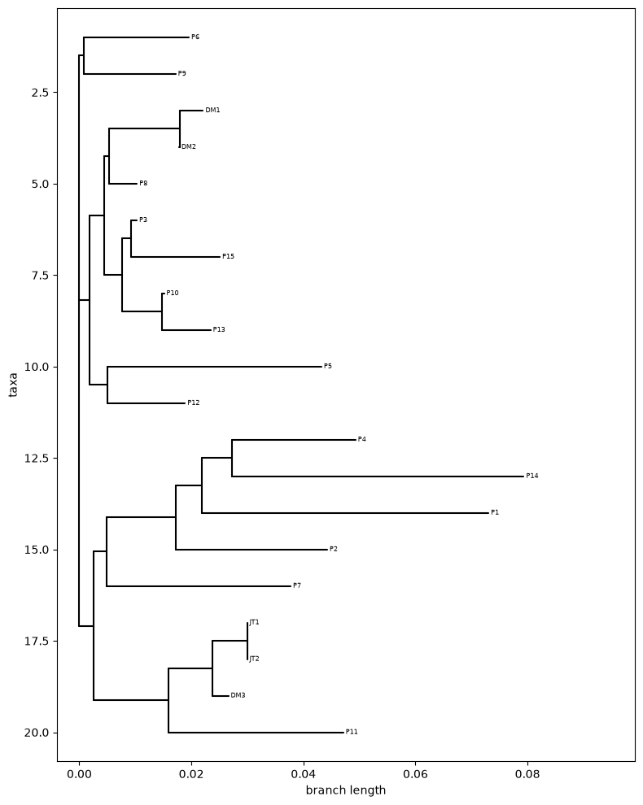

# Introduction
In this project, we use distance-based phylogeny to explore the relationships among 20 HIV-1 reverse transcriptase protein sequences. We compare the sequences using Smith–Waterman local alignment and convert their similarities into a distance matrix. We then use neighbor joining to build a tree by repeatedly joining pairs based on their distances to each other and to the remaining nodes. Unlike UPGMA, neighbor joining does not assume that all lineages evolve at the same rate. The resulting unrooted tree shows relationships among the sequences without identifying a common ancestor or the direction of evolution.

# Pseudocode
```
FUNCTION read_fasta(filename):
    INITIALIZE empty sequences dictionary
    SET current_id to None

    OPEN file
    FOR each line:
        Remove surrounding whitespace
        IF line is empty:
            Skip line

        IF line starts with ">":
            Get ID from last word after ">", SET current_id to ID
            Initialize empty list for this ID
        ELSE:
            Append uppercase line to current sequence's list

    Join each sequence's list into one string
    RETURN sequences dictionary


FUNCTION smith_waterman_normalized_distance(sequence1, sequence2):
    USE textdistance Smith-Waterman normalized distance function
    RETURN distance rounded to 3 places


FUNCTION build_distance_matrix(sequences):
    Get sequence IDs as labels
    Get sequences
    SET n to number of sequences
    INITIALIZE n × n distance matrix with zeros

    FOR i from 0 to n - 1:
        FOR j from i + 1 to n - 1:
            Get sequences for labels[i] and labels[j]
            Calculate normalized similarity using smith_waterman_scoring
            Calculate distance = 1 - similarity

            Store distance at [i, j] and [j, i]

    RETURN distance matrix and labels

FUNCTION neighbor_joining(distance_matrix, labels):
    Initialize values for nodes
    Add up each row of matrix
    Score using D*
    join pair + limb measure
    update matrix
    recursion
```

# Dependencies
| Package | Version |
|---|---|
| textdistance | 4.6.3 |
| matplotlib | 3.11.2 |
| biopython | 1.88 |
| numpy | 2.5.3 |


# Results
## Formula and distance transformation 
`distance = textdistance.smith_waterman.normalized_distance(sequence1, sequence2)`  
**Gives (# differences)/(sequence length), this might not have worked well with sequences of varying lengths**

`distance_star = (nodes - 2) * distance_matrix[i,j] - TD_array[i] - TD_array[j]`  
**Gives D\* using a distance matrix(distance_matrix) and it's row sums (TD_array)**

`branch_split = (TD_array[row] - TD_array[column])/(nodes - 2)`  
`length_i = 0.5 * (distance_matrix[row, column] + branch_split)`  
`length_j = distance_matrix[row, column] - length_i`  
**Gives branch lengths of i and j using a distance matrix(distance_matrix) and its row sums (TD_array)**

**Final Three Nodes**  
The instructions in this notebook continued joining pairs until two active nodes remain, then connect them with a final branch. Our implementation follows the provided HTML tutorial instead, stopping when three active nodes remain and connecting them to a new central node. I believe that both approaches are valid ways to do neighbor joining. 

## Ouput
The neighbor-joining tree shown below contains all 20 HIV-1 reverse transcriptase sequences. JT1 and JT2 have identical sequences and appear together with zero-length branches. DM1 and DM2 also group closely together. Branch lengths reflect distances calculated using normalized Smith–Waterman scores. 



# Successes
We were able to produce a plausible tree. Additionally, despite scheduling conflicts, we were able to meet and make a lot of improvements to our code. We were then able to finalize the code to a working state over teams.  

# Struggles
The entire neighbor joining function was a struggle. Probably the biggest aspect of this was updating the distance matrix and labels correctly. For example, we were getting an index out or range error after the first iteration. We ended up realizing by printing the matrix that this was becasue we appended the new nodes values as a column but not a row, which made the matrix not a square. Similarly, we had an issue were, when deleting the joined neighbors from labels, the wrong labels were being removed. Also through a print statment we realized this was becasue after the first deletion the indexing of the list changed, making the second deletion occur on the wrong item. To fix this we stopped deleting labels by index and instead used remove() and their name.

We also contemplated various distance calculation methods, but the textdistance method was choosen becuase of its simplicity. 

Also, we were not able to complete some of the tasks as outlined in the project canvas page, such as constructing our own D* formula and comparing to Saitou and Nei (1987). For the sake of time we pulled our equations from the provided HTML and are as stated above.  

# Personal Reflections
## Group Leader
**Matthew (Jake)**  
I found this project to be challenging, potentially the hardest one yet. Despite this, I felt like the group overcame a lot of the challenges presented by the project and we actually produced a result, which was not looking like it was going to happen for most of the project. I can't say im extremely condident the result is "correct" though it does seem plausible based on how things are named and how they are organized on the tree. I think the reasons I am still hesitant about the results is becasue I wasn't really confident about a lot of things in this project. For example, what distance calculation to use and how to normalize it. We ended up using textdistance's normalized Smith Waterman function, but the distance matrix produced wasn't exaclty equal to the 3x3 sample shown in the build_distance_matrix documentation. Also, I thought maybe we should remove the two sample with the sample sequence, though they seem like they were handled fine. Finally, as may be evident from the pseudocode of neighbor_joining(), we didn't really have a plan for this. Basically it took a lot of following the HTML and trial and error, but eventually we got something that seems to work. 

## Other members
**Selin Uenal**
I found this project very challenging, especially understanding how all the steps in neighbor joining fit together. Working through the code one part at a time helped me understand what the D* matrix does and how the distances and branch lengths are updated after each join. Working through the code together with my group members helped me understand the concepts much more clearly. One thing that helped was testing the algorithm on a small matrix where we knew the expected result. I also learned about how Newick strings represent trees. Overall, I feel more comfortable with the algorithm now, although I would have liked to spend more time on this project. 

**Abigail Ackor**


# Generative AI Appendix
As per the syllabus
